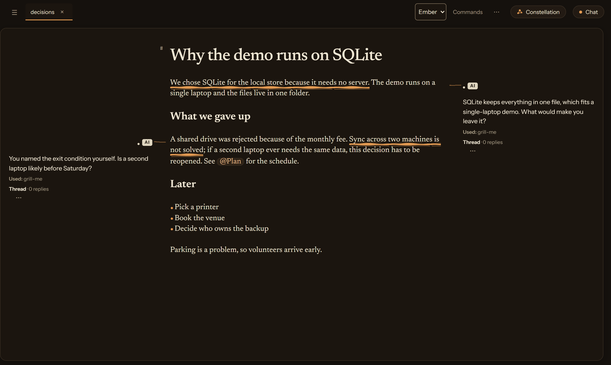
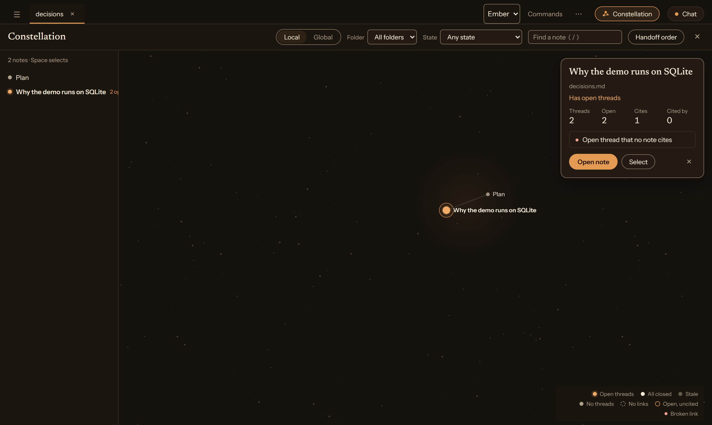

<div align="center">


<br>

**A local-first decision notebook for the choices you make while coding with AI.**

`Plain Markdown on disk` &nbsp;·&nbsp; `AI always labelled` &nbsp;·&nbsp; `Nothing sent unseen` &nbsp;·&nbsp; `Windows first`

</div>

<br>

<div align="center">

</div>

<br>

## &nbsp;01 &nbsp; Ink beside the text, never inside it



Select a sentence. A thought grows in the margin and stays tied to it, with a filled **AI** tag, so you always know whose words you are reading.
Your note stays **byte-for-byte your Markdown**. The ink lives next to the file, so CRLF, BOM and every trailing newline round-trip untouched.

<br>

## &nbsp;02 &nbsp; See exactly what leaves the machine


Every message gets a review card first: your question, the note, the threads, the instructions, the token budget. *Nothing has gone to Claude yet. It will see exactly this, and nothing else.*

<br>

## &nbsp;03 &nbsp; Watch the notebook connect



Notes become stars. Open threads glow. Broken links and threads nobody cites are one glance away.

<br>

<div align="center">

</div>

<br>

## &nbsp;Rules the app keeps

| | |
|---|---|
| **The why is yours** | AI never writes your takeaway, your reasons, or a failed reason. |
| **Asked, not assumed** | No proactive comments. Edits come only from something you did: typing, a toolbar, a shortcut, a click. |
| **Look, then send** | A plan card for anything bigger than a chat: files, repo, diagrams, a cost cap. Raising it asks again. |
| **Read-only investigations** | *Investigate* reads a throwaway copy of your repo, never the repo itself, with secrets filtered out. |
| **Your files, byte-exact** | Rendering is display only. Decorations never change the document. |
| **Local** | No accounts, no hosted backend, no network fonts. The app never handles your Claude credentials. |

<br>

## &nbsp;Run it

Needs Node 24+.

```powershell
cd ui
npm install
npm run build
node server/main.ts --root <your-project>\.aitiarch
```

The notebook opens in your browser. Details and the practice notebook: [ui/README.md](ui/README.md).

<br>

## &nbsp;Read on

[BRIEF.md](BRIEF.md) the vision and the principles the human keeps &nbsp;·&nbsp; [JOURNEY.md](JOURNEY.md) how it was built, with the measurements &nbsp;·&nbsp; [NOTES.md](NOTES.md) findings and open problems &nbsp;·&nbsp; [docs/build-plan.md](docs/build-plan.md) the plan &nbsp;·&nbsp; [docs/try-it.md](docs/try-it.md) a guided first run &nbsp;·&nbsp; [ARCHIVE.md](ARCHIVE.md) the early experiments

<br>

<div align="center"><sub>Screenshots are of the real app on a synthetic notebook.</sub></div>
