<div align="center">


<br>

**A local-first decision notebook for the choices you make while coding with AI.**

`Plain Markdown on disk` &nbsp;·&nbsp; `AI always labelled` &nbsp;·&nbsp; `Nothing sent unseen` &nbsp;·&nbsp; `Windows first`

</div>

<br>

## &nbsp;Chat is a straight line. Thinking branches.

Every AI chat is one column that scrolls away. You can't fork it, you can't park a failed attempt in it, and you can't see which idea led to which. The more the model does for you, the less you decide, until all that is left is pressing buttons. We call that **AI dumbification**, and a chat window is where it happens.

Real work is a tree. You plan something, you try it, it works or it doesn't, and either way it branches: a win opens the next question, a failure opens three more. **Aitiarch is a notebook built for that shape.**

<div align="center">
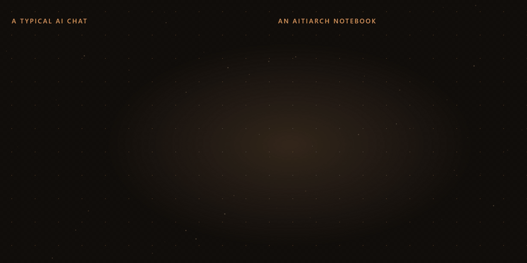
</div>

- **You write the thinking.** Plans, steps, what worked, what failed and why. The takeaway and the reasons are yours; the AI never writes them.
- **Threads fork.** Any sentence can grow a thread. A failed attempt stays in the note, with its reason, instead of scrolling away.
- **Claude Code and Codex are evidence, not authors.** Pull in the past sessions you choose, read exactly what will be sent, and have every claim checked against its source. *Investigate* works on a throwaway, read-only copy of your repo.
- **The constellation shows what connects to what.** Notes become stars, links become lines, open threads glow.

<div align="center">
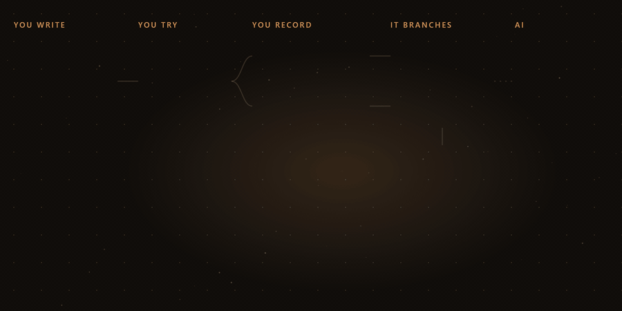
</div>

<br>

<div align="center">

</div>

<br>

<div align="center">

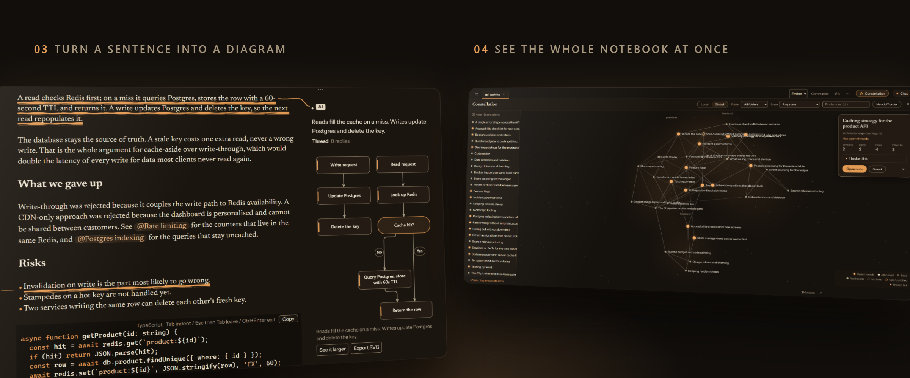
</div>

<br>

## &nbsp;How a question travels

<div align="center">
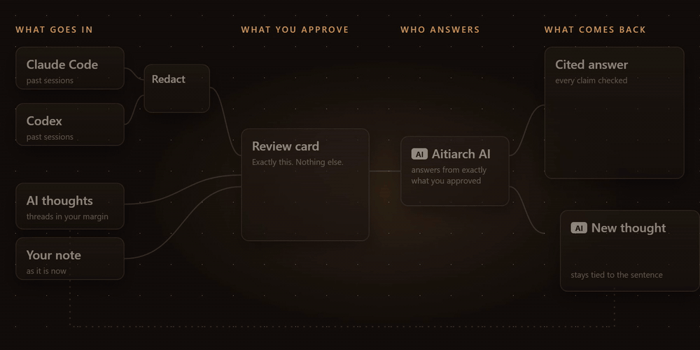
</div>

<br>

## &nbsp;01 &nbsp; Ink beside the text, never inside it

<div align="center">
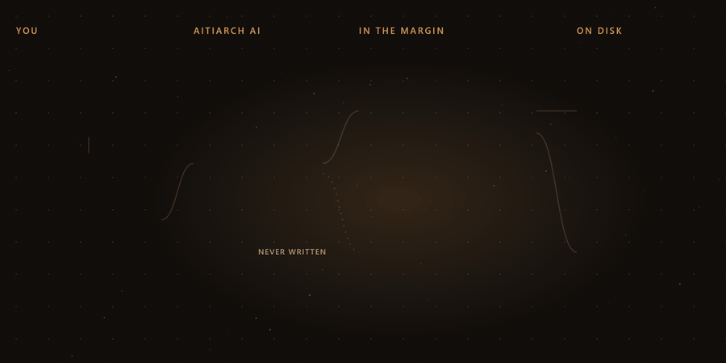
<br>
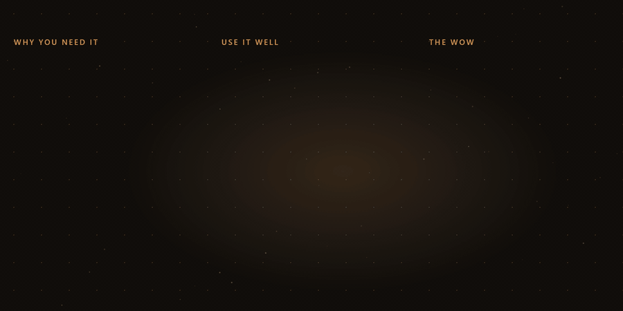
<br>

</div>

Select a sentence. A thought grows in the margin and stays tied to it, with a filled **AI** tag, so you always know whose words you are reading.
Your note stays **byte-for-byte your Markdown**. The ink lives next to the file, so CRLF, BOM and every trailing newline round-trip untouched.

<br>

## &nbsp;02 &nbsp; See exactly what leaves the machine

<div align="center">
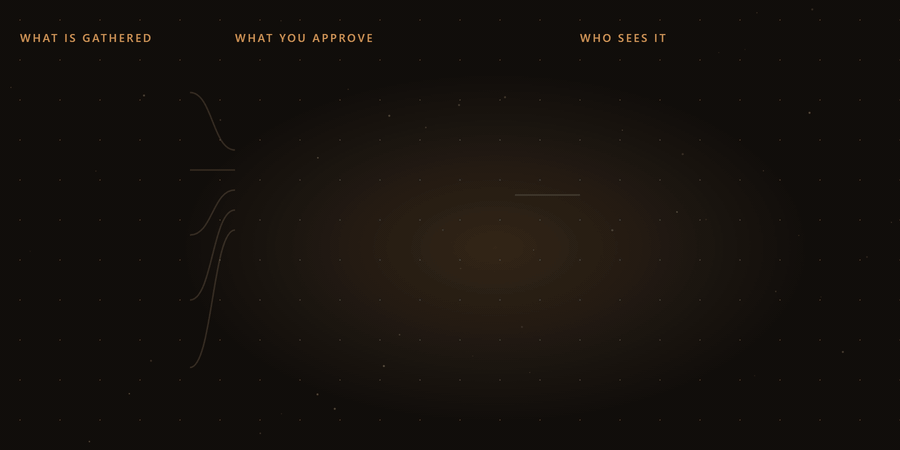
<br>

<br>

</div>

Every message gets a review card first: your question, the note, the threads, the instructions, the token budget. *Nothing has gone to Claude yet. It will see exactly this, and nothing else.*

<br>

## &nbsp;03 &nbsp; Bring in your Claude Code and Codex sessions

<div align="center">
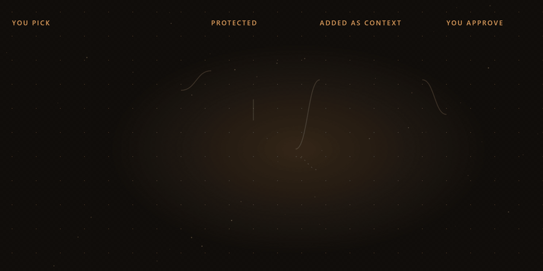
<br>

<br>

</div>

Past **Claude Code** and **Codex** sessions for this project show up in one picker. Tick the ones that matter and read the redacted text, key-like tokens already blanked, before a word is sent.
Chats that carry sessions stay in memory only, and *Add to note* is switched off for them.

<br>

## &nbsp;04 &nbsp; Every claim, checked against its source

<div align="center">
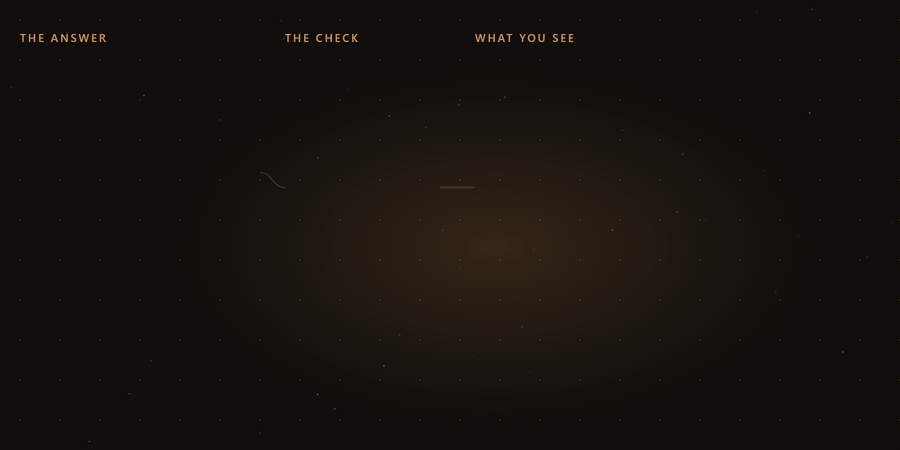
<br>

<br>

</div>

Each claim in an answer becomes a chip: the note, a thread, a session. The app looks for the quoted words in that exact source and says **Found** or **Quote not found**. Words, never colour alone.

<br>

## &nbsp;05 &nbsp; Add to note, as plain Markdown

<div align="center">
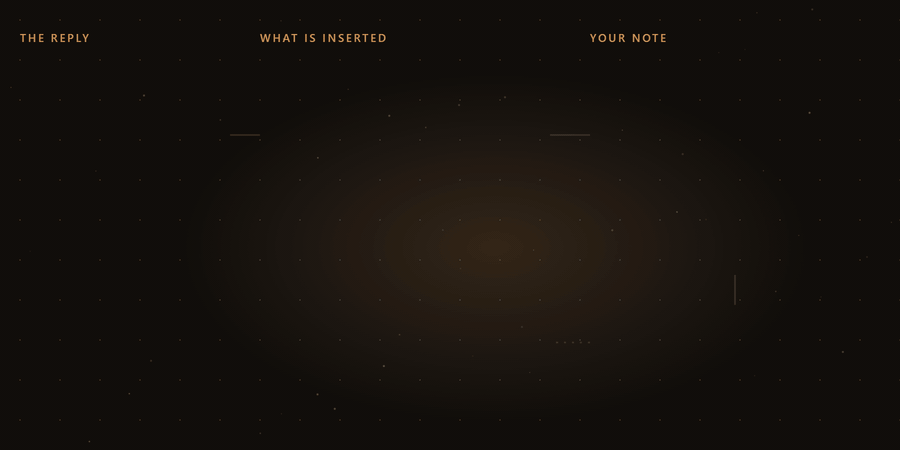
<br>
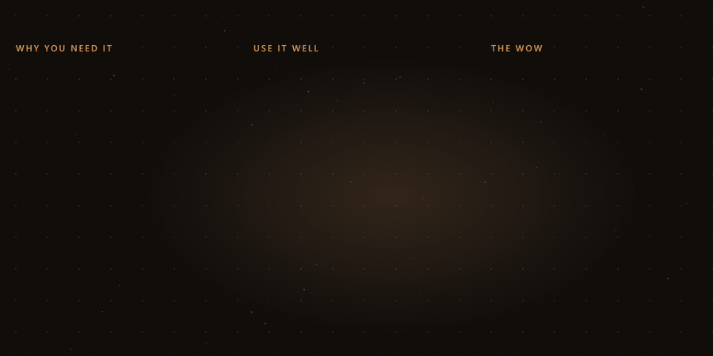
<br>
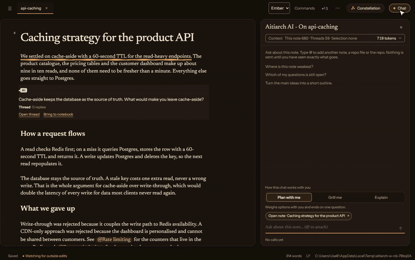
</div>

One click puts the answer in the note as an AI-labelled callout. It is ordinary Markdown, one undo away, and your BOM and line endings stay as they were.

<br>

## &nbsp;06 &nbsp; Turn a sentence into a diagram

<div align="center">
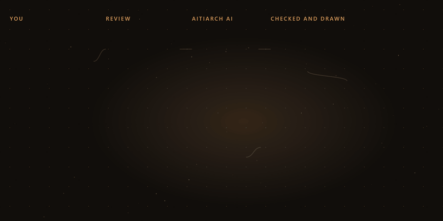
<br>
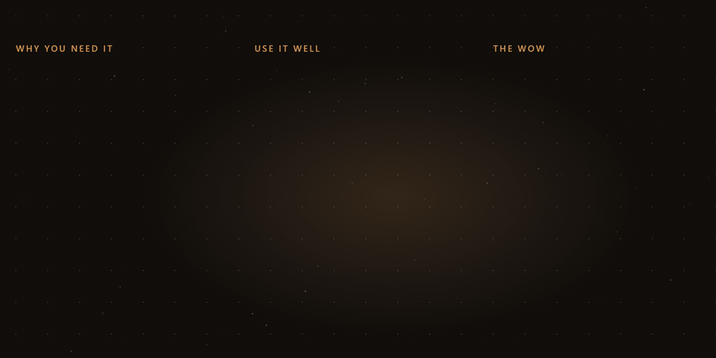
<br>
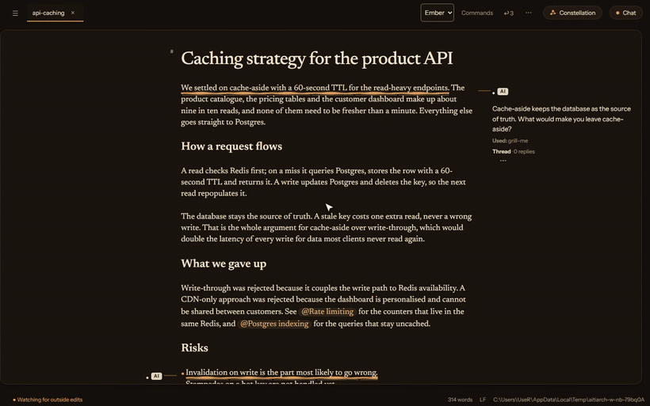
</div>

<br>


<br>


Select a sentence, press **Visualize**, review, send. The diagram appears in the margin, ready to enlarge or export as SVG. Bring it into the note and it sits under an AI-labelled callout, saved beside the file as an image that follows light and dark.

<br>

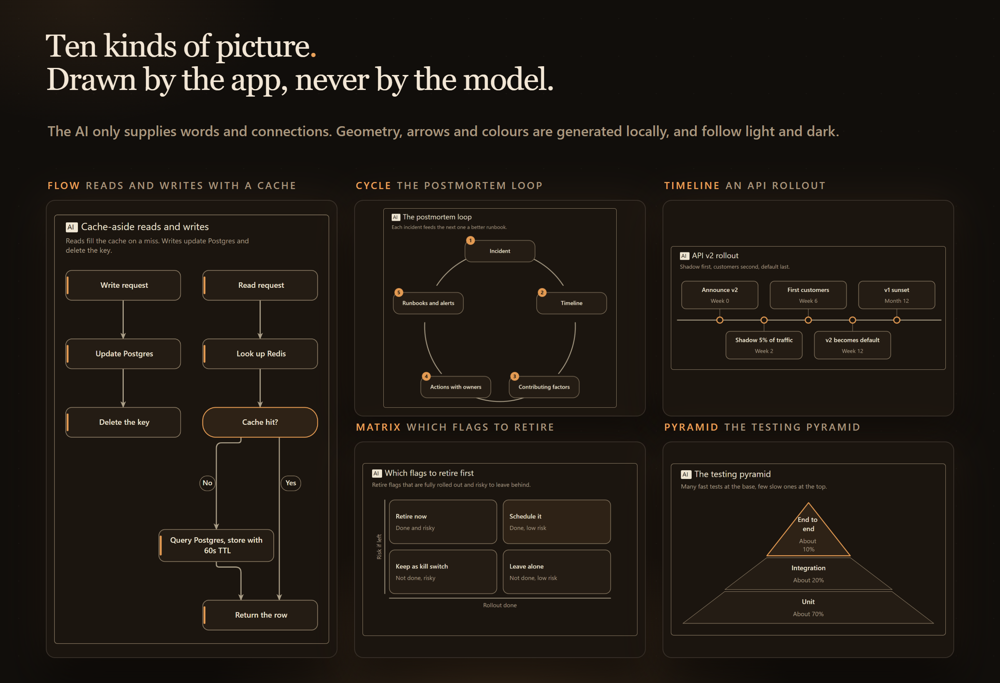

The AI only supplies words and connections. The app lays out and draws every box, arrow and axis itself, in your theme's colours.

<br>

## &nbsp;07 &nbsp; See the whole notebook at once

<div align="center">
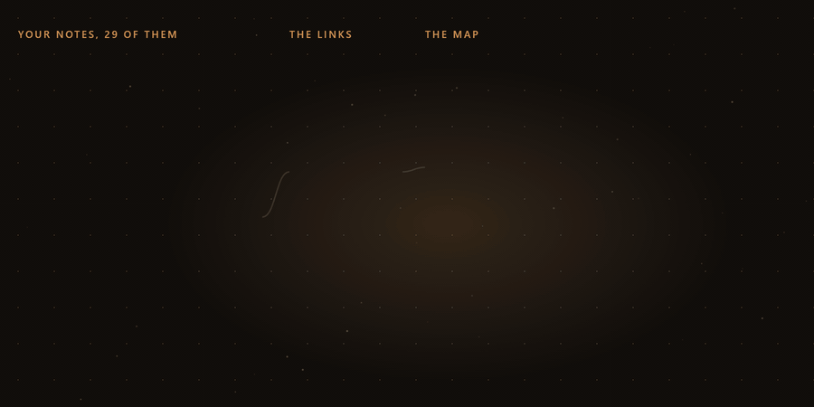
<br>
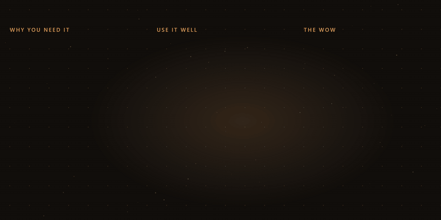
<br>

</div>

<br>


Notes become stars and links become lines. Open threads glow. Notes nothing cites and links that lead nowhere are one glance away. Filter by folder or state, or find a note by name.

<br>

<div align="center">
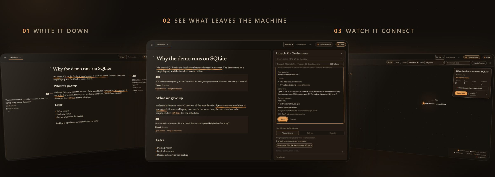
</div>

<br>

## &nbsp;Rules the app keeps

| | |
|---|---|
| **The why is yours** | AI never writes your takeaway, your reasons, or a failed reason. |
| **Asked, not assumed** | No proactive comments. Edits come only from something you did: typing, a toolbar, a shortcut, a click. |
| **Look, then send** | A review card for every message. A plan card for anything bigger: files, repo, diagrams, a cost cap. Raising it asks again. |
| **Read-only investigations** | *Investigate* reads a throwaway copy of your repo, never the repo itself, with secrets filtered out. |
| **Your files, byte-exact** | Rendering is display only. Decorations never change the document. |
| **Local** | No accounts, no hosted backend, no network fonts. The app never handles your Claude credentials. |

<br>

## &nbsp;Run it

Needs Node 24+.

```powershell
cd ui
npm install
npm run build
node server/main.ts --root <your-project>\.aitiarch
```

The notebook opens in your browser. Details and the practice notebook: [ui/README.md](ui/README.md).

<br>

## &nbsp;Read on

[BRIEF.md](BRIEF.md) the vision and the principles the human keeps &nbsp;·&nbsp; [JOURNEY.md](JOURNEY.md) how it was built, with the measurements &nbsp;·&nbsp; [NOTES.md](NOTES.md) findings and open problems &nbsp;·&nbsp; [docs/build-plan.md](docs/build-plan.md) the plan &nbsp;·&nbsp; [docs/try-it.md](docs/try-it.md) a guided first run &nbsp;·&nbsp; [ARCHIVE.md](ARCHIVE.md) the early experiments

<br>

<div align="center"><sub>Every screenshot and clip is the real app, or built from it, on a synthetic notebook of invented engineering notes, with fake providers and fake sessions.</sub></div>
